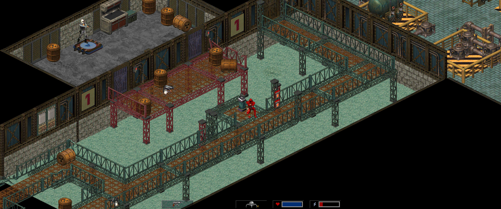

# Crusader: No Remorse — DECOMP


A C++20/SDL2 reimplementation of the *Crusader: No Remorse* (Origin, 1995) engine for Windows and Linux. The project is still a **work in progress**.



This repository contains **no game files**: you need your own copy of the original game. The following versions are currently supported:

- The **French version 1.08** (dated 12 October 1995) — ISO SHA-256: `B370436F2BA380500E918262A83293FBB89600253CC3F4579895D45FDB63B802`
- The **US version 1.23** (dated 13 February 1996) — ISO SHA-256: `C27D77D215253B8C1EF3C5B16CC33AFF63E759A843BBCD177A42F6A64DC063C7`
- The **English version 1.01** (dated 14 September 1995), sold by GOG — ISO (`GAME.GOG`) SHA-256: `7C2FAA4140F5D7FDDD0F1E3191DED0D10FB3DCF8908BD8559866C253D7B6638B`

## Recent improvements

- **Level editor** (`crusader-editor`): edit the original maps or create new ones, with the game's own renderer: scenery, globs (prefab rooms), NPCs, and the eggs and item links that drive the scripts. It saves to a mod folder that the game plays with `--mod` (the original data is never modified). Press **F5** in the editor to test the level. See [docs/EDITEUR.md](docs/EDITEUR.md) (in French).

- Added gamepad support with vibration.
- Added an **Enhancements** menu to the Options menu, with:
  - Gamepad remapping
  - A camera that follows the player
  - Directional movement: the controller's left stick walks the Silencer where it points, as an alternative to the original tank controls; while the right stick aims, it strafes relative to the aim
  - Directional aiming: the right stick puts the crosshair where it points
  - Native resolution: the view fills your screen (in whole-number pixel multiples, never stretched), showing more of the surroundings; the menus and cutscenes stay 640×480, centred
  - Zoom: choose the pixel size of the native view (Auto, or ×1 to ×4); ×1 gives the finest picture and the widest view
  - Autosave: the game saves itself when you pick up a keycard, open a door with a keycard or a code, open a chest with a code, start a level, and after each cutscene of the mission (a floppy disk shows in the corner). It uses its own slot, separate from your saves; load it from the last row of the load screen or press **F6**
- Fullscreen toggle: press **Alt+Enter** at any time to switch between windowed and fullscreen.

## Planned improvements

- Release the game on PortMaster.
- Support additional versions of *Crusader: No Remorse*, if there is interest.
- Explore the possibility of supporting *Crusader: No Regret*.
- Level editor: script (usecode) disassembly and assembly, sprite import, NPC type editing.
- Have an idea? Let me know what you'd like to see!

Further improvements will come when my Claude subscription renews. If you'd like to help speed things up, feel free to leave a small tip (see [SPONSORING.md](SPONSORING.md)).

## Running the game

### 1. Download

Download the latest release from the [Releases](https://github.com/sebsebseb1982/crusader-no-remorse-decomp/releases) page:

- Windows: `crusader-X.Y.Z-windows-x64.zip` (SDL2 is built into the executable)
- Linux: `crusader-X.Y.Z-linux-x64.tar.gz` — requires SDL2: `sudo apt install libsdl2-2.0-0` (or your distribution's equivalent)
- aarch64 handhelds (PortMaster: muOS, Knulli, ROCKNIX, ArkOS…): `crusader-X.Y.Z-portmaster-aarch64.zip` — see [`tools/portmaster/README.md`](tools/portmaster/README.md)

Checksums are in `SHA256SUMS`.

### 2. Provide the game data

The archive contains the executable and an empty `data` folder with a `PUT_GAME_DATA_HERE.txt` note. Add the game data from your copy of a supported version (French 1.08, US 1.23 or English 1.01) in one of these ways:

- **CD image:** Place the `.iso` file in `data/`, or pass its path to the game (for example, `./crusader game.iso`). The GOG release's `GAME.GOG` is such an image and works the same way, under its own name. On first launch, the game extracts the data to `data/` (about 550 MB; this takes a few seconds). You can delete the ISO afterward.
- **Installed game or CD files:** Copy the **entire contents** of the installation folder or CD into `data/`:

```
crusader(.exe)
data/
├── CRUSADER.CFG        settings
├── STATIC/             shapes, palettes, fonts, maps, tables  (SHAPES.FLX, FIXED.DAT, GLOB.FLX, TYPEFLAG.DAT, ANIM.DAT, GUMPS.FLX, FONTS.FLX, *.PAL, …)
├── USECODE/            game scripts  (EUSECODE.FLX, UNKCOFF.DAT, UNKDS.DAT)
├── SOUND/              sound effects and music  (SOUND.FLX, M01.AMF … M16C.AMF, MENU.AMF, CRED.AMF)
├── FLICS/              cutscenes  (*.AVI and their subtitles *.TXT)
└── SAVEGAME/           saved games (optional for a new game)
```

### 3. Launch

```sh
./crusader data --new-game        # Windows: crusader.exe data --new-game
./crusader data --save 1          # resumes SAVEGAME.1 from the data folder
./crusader --version
./crusader data --mod mods/my-level --map 3   # plays a level made with crusader-editor
./crusader-editor data --mod mods/my-level    # the level editor
```

## Building from source

Requirements: CMake 3.21 or later and a C++20 compiler (Visual Studio 2022, GCC 11+, or Clang 14+).

```sh
cmake -S . -B build -DCMAKE_BUILD_TYPE=Release     # Windows: -G "Visual Studio 17 2022" -A x64
cmake --build build --config Release
ctest --test-dir build -C Release --output-on-failure
```

If SDL2 is installed on your system, the build uses it (`libsdl2-dev` on Linux). Otherwise, SDL2 is downloaded and built automatically.

The tests in `tests/` do not require game data. The end-to-end tests in `e2e/` use the original game data and are registered only when it is found (`-DCRUSADER_DATA_DIR=…`; defaults to `data/`). Tests that load saved games read them from `-DCRUSADER_TEST_SAVES_DIR=…` and are skipped if that directory is absent. `us_data_tests` runs when US game data is found (`-DCRUSADER_US_DATA_DIR=…`; defaults to `data_us/`).

In addition to `crusader`, the build produces several tools: `shapeview` (shape viewer), `mapview` (map viewer), `ucsmoke` and `useprobe` (script execution), and `diffcheck` (comparison with the original).

## Versioning

Versions follow [SemVer](https://semver.org) and are calculated automatically from [Conventional Commits](https://www.conventionalcommits.org): `fix:` increments the patch version, `feat:` increments the minor version, and `BREAKING CHANGE` increments the major version (or the minor version before `1.0`). Every release is built and tested on Linux and Windows, and cross-compiled for PortMaster. See [`docs/RELEASING.md`](docs/RELEASING.md) for details.

## Contribution

Contributions are welcome; see [CONTRIBUTING.md](CONTRIBUTING.md) for the full guide. For substantial changes, please open an issue first to discuss the proposed approach. When reporting a bug, include the game version, operating system, screenshot, savegame, steps to reproduce it, and any relevant error messages or logs.

Pull requests should describe the change and its purpose, stay focused, and include tests where appropriate. Before submitting one, build the project and run the available tests:

```sh
cmake --build build --config Release
ctest --test-dir build -C Release --output-on-failure
```

Tests that require the original game data will run only when the data is available and configured as described above.

## License and rights

The port's code and documentation are released under the [GNU GPL v3](LICENSE) or, at your option, any later version. You may use, study, modify, and redistribute them, provided that every redistributed version, modified or not, remains under the same license and includes its source code.

This license applies only to this repository. *Crusader: No Remorse* remains the property of its rights holders. This project does not distribute the game's code or data. You must own a copy of the game to play it.
